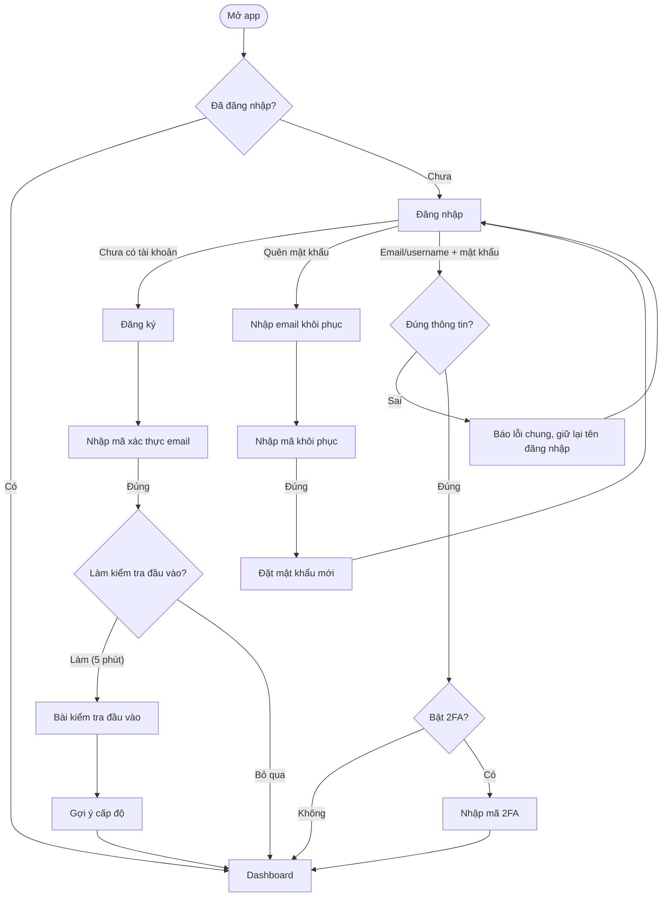
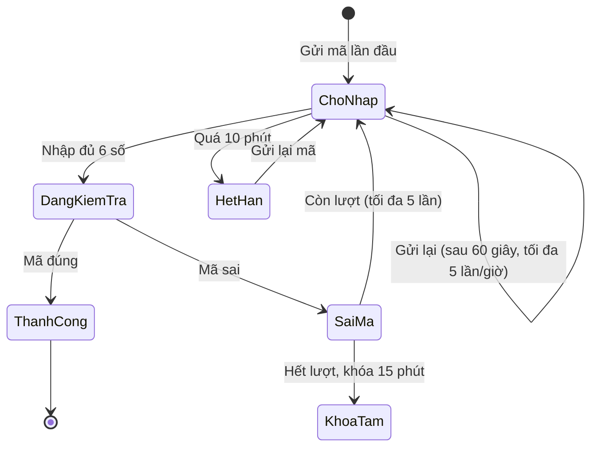
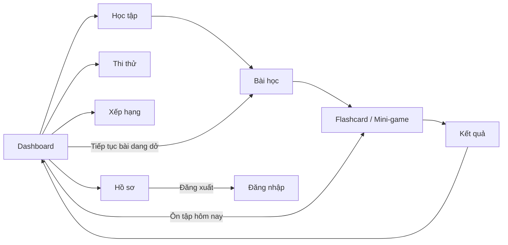

# User flow: Auth & Dashboard (SCRUM-44)

Wireframe low-fi tương ứng: mở [`docs/ux/wireframes.html`](./wireframes.html) bằng trình duyệt. Đây là bản tham chiếu để vẽ lại trên Figma.

## 1. Luồng tổng quát

## 2. Màn hình nhập mã (dùng chung cho đăng ký, 2FA, quên mật khẩu)

Con số trên là **đề xuất**, cần nhóm Backend xác nhận: mã có hiệu lực 10 phút, mỗi lần gửi lại cách nhau 60 giây, tối đa 5 lần gửi mỗi giờ, nhập sai 5 lần thì khóa 15 phút. Phần này đáp ứng yêu cầu "giới hạn gửi mã xác nhận qua email" trong scope.

## 3. Điều hướng từ Dashboard

## 4. Quy tắc UX cho từng màn

| Màn | Quy tắc |
|---|---|
| Đăng nhập | Ô đầu tiên nhận **email hoặc tên đăng nhập**. Sai thông tin thì hiện lỗi chung "Email/tên đăng nhập hoặc mật khẩu không đúng", không tiết lộ sai ở ô nào. Có nút hiện/ẩn mật khẩu. Khi lỗi, giữ lại nội dung ô tên đăng nhập. |
| Đăng ký | Có thêm ô **tên đăng nhập**, vì đăng nhập cho phép dùng username. Có thanh đo độ mạnh mật khẩu. Kiểm tra lỗi ngay khi rời ô (on blur), không đợi đến lúc bấm gửi. |
| Nhập mã | 6 ô, tự nhảy sang ô kế tiếp, cho phép dán cả mã. Hiện email đã che bớt (h\*\*\*@gmail.com). Nút "Gửi lại" đếm ngược. |
| Quên mật khẩu | Luôn báo "Nếu email tồn tại, mã đã được gửi", để không lộ email nào đã đăng ký. |
| Dashboard | Người mới (chưa có dữ liệu) thấy **trạng thái rỗng** kèm CTA "Bắt đầu bài đầu tiên", không hiện số liệu giả. Mục tiêu ngày và chuỗi luôn nằm trên phần đầu màn hình. |
| Mobile (< 760px) | Thanh điều hướng chuyển xuống dưới (bottom tab bar), nút bấm cao tối thiểu 44px. |

## 5. Khác biệt so với code hiện tại

Các điểm dưới đây cần nhóm UI/Backend xử lý khi làm theo wireframe:

1. **Bảo mật:** form Đăng nhập, Đăng ký, Xác thực, Quên mật khẩu đều dùng `method="get"`. Mật khẩu vì thế hiện trên thanh địa chỉ và bị lưu vào lịch sử trình duyệt cùng log server. **Phải đổi sang `method="post"`.**
2. Ô đăng nhập đang ghi "Tên đăng nhập", chưa nhận email như yêu cầu ("đăng nhập bằng username + password hoặc email").
3. OTP đang hard-code `123456` ở cả client (`wwwroot/js/authentication.js`) và server (`Program.cs`), chưa có gửi mã qua email. Giữ dòng gợi ý mã trên trang Xác thực cho đến khi Backend tích hợp email OTP (Supabase Auth); sau đó xóa gợi ý và hai điểm hard-code.
4. Chưa có nút "Gửi lại mã" và chưa giới hạn số lần gửi.
5. Trang Đăng ký chưa có ô tên đăng nhập và ô xác nhận mật khẩu.
6. Chưa có màn **Đặt mật khẩu mới** sau khi nhập mã khôi phục, cũng chưa có màn **kiểm tra đầu vào**. Scope đang ghi "kiểm tra đầu vào?" nên nhóm cần chốt có làm hay không.
7. Dashboard chưa có mục tiêu ngày, lịch chuỗi theo tuần, huy hiệu và mục "Ôn tập hôm nay", trong khi scope có hệ thống chuỗi, tiến trình và huy hiệu.
